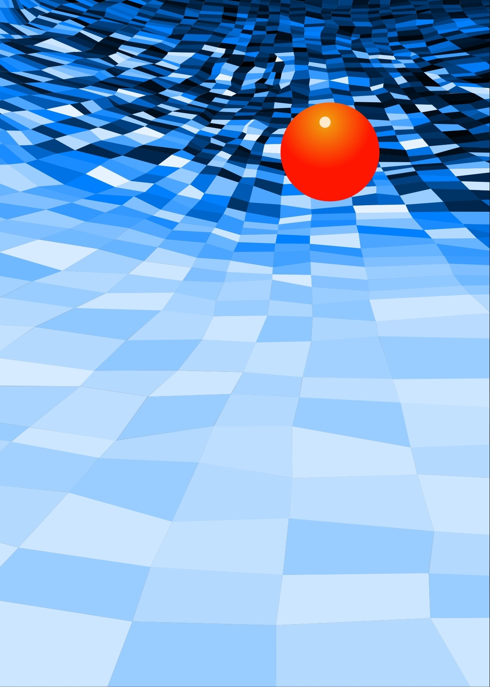

# Art

Based on Dave Everitt's artwork.

## Todo

- [ ] fading? transitions?
- [ ] another glitter style
- [x] preset certain speeds, change random freqs
- [x] fix glitter to only take black outline lines
- [x] fix random selection combinations, i.e. line colour, fill, gradient, etc
- [x] with or without stroke hardcoded into styles
- [x] horizontal gradient?
- [x] diff between blacktoblack and blacktocolour???
- [x] remove colouriseWhitish
- [x] change colour lines
- [x] fix gradients

